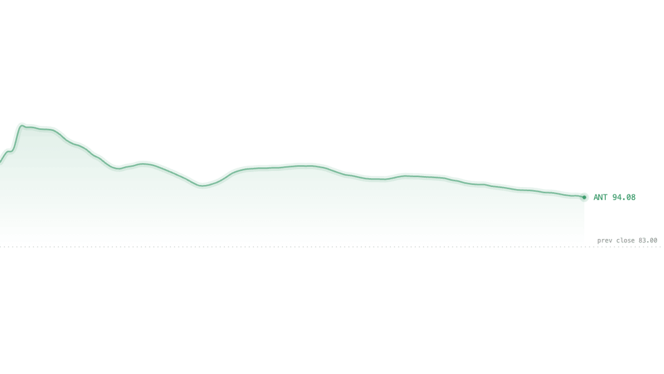
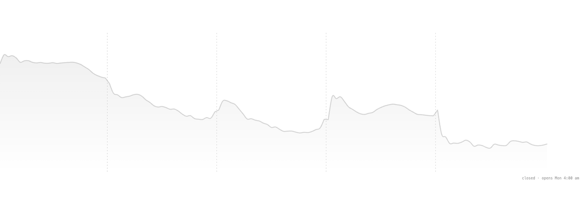

# Ticker theme for the Claude desktop app

A white page with one stock's day drawn as a single soft line, **updating live every 10 seconds**, pre-market and after-hours included. Nothing else, except two numbers at the right: yesterday's close, and the price now.



*The preview is real ANT prices recorded 10 seconds apart, played 5 times faster.*

## Live updates

Every 10 seconds from 4 am to 8 pm New York time on weekdays (pre-market, the regular session and after-hours), the theme fetches the latest price. Outside those hours it stops asking. On a weeknight the day's chart stays, grayed out, with a small note saying when trading opens again. On a weekend it shows the last five trading days instead, as one faint gray line with a mark between days. The end of the line and the number move with it, and a new point joins the line each minute. When the price has not changed, nothing is redrawn.



*While the market is closed: the last five trading days (shown here with AAPL), each starting at its open, so overnight jumps show.*

With the theme open in many sessions, they share one saved copy of the price: whichever session looks first after it is ten seconds old fetches it, and the rest read that copy. So ten open sessions still make about one request every ten seconds, not ten.

## What it shows

- **The line:** today's price from the start of the pre-market at the left to now at the right, smoothed so it flows instead of jitters. Green where it is at or above yesterday's close, red below it, with a faint wash between the two.
- **The dotted line:** yesterday's close, labeled `prev close 83.00`. On a stock's first trading day there is no close yet, so it uses today's open and says `open`.
- **The number at the line's end:** the price now, green or red the same way.

Prices come from Yahoo Finance's public chart address, which needs no account or key. It is not an official API: it can lag, rate-limit or stop without notice, and then the picture keeps its last price. Outside market hours it shows the last trading day and stays still.

Right now the stock is fixed in the code: `ANT` (Anthropic). To watch another one, change `SYMBOL` in `hooks/register.tsx`.

The numbers are for looking at, not for trading on.

## Install

In a terminal session, at the prompt:

```
/plugin install ticker-theme --marketplace cktang88/claude-ticker-theme
```

From a shell:

```
claude plugin install ticker-theme --marketplace cktang88/claude-ticker-theme
```

In the desktop app, where `/plugin` does not run: click + next to the prompt box, then Plugins, Add marketplace with `cktang88/claude-ticker-theme`, then Add plugin.

`/ticker` turns the theme on again, `/ticker off` clears it for the session.

Only tried on the macOS desktop app.

## Tests

```
bun test
```

`hooks/make-colors.js` is the color helper that ships with Claude Code's plugin-authoring skill, copied in unchanged.
