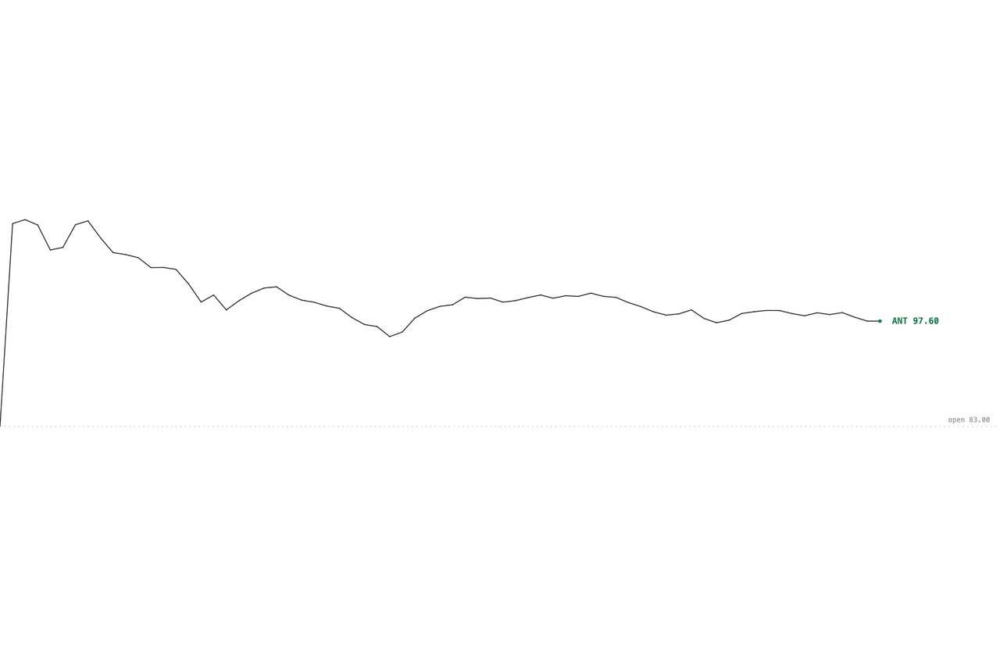

# Ticker theme for the Claude desktop app

A white page with one stock's day drawn as a single jagged line. Nothing else, except two numbers at the right: what it opened at today, and the price now.



## What it shows

- **The line:** the day's price, one point a minute, from the open at the left to now at the right.
- **The dotted line:** the day's opening price, with `open 83.00` at its right end.
- **The number at the line's end:** the price now. Green when it is at or above the open, red below it.

The price is fetched every ten seconds from Yahoo Finance's public chart address. The picture is drawn again only when the price moved. Outside market hours it shows the last trading day and stays still.

Right now the stock is fixed in the code: `ANT` (Anthropic). To watch another one, change `SYMBOL` in `hooks/register.tsx`.

The numbers are for looking at, not for trading on: the feed can lag, and it can fail without notice (the picture then keeps its last price).

## Install

In a terminal session, at the prompt:

```
/plugin install ticker-theme --marketplace cktang88/claude-ticker-theme
```

From a shell:

```
claude plugin install ticker-theme --marketplace cktang88/claude-ticker-theme
```

In the desktop app, where `/plugin` does not run: click + next to the prompt box, then Plugins, Add marketplace with `cktang88/claude-ticker-theme`, then Add plugin.

`/ticker` turns the theme on again, `/ticker off` clears it for the session.

Only tried on the macOS desktop app.

## Tests

```
bun test
```

`hooks/make-colors.js` is the color helper that ships with Claude Code's plugin-authoring skill, copied in unchanged.
